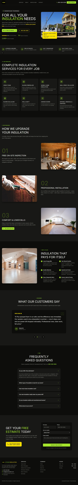

# A Plus Insulation — Website

Marketing site for **A Plus Insulation**, an insulation contractor serving Panama City
and the Florida Gulf Coast. Built with the Next.js App Router, React 19, Tailwind CSS v4,
and shadcn/ui, with local SEO (LocalBusiness / FAQ / Breadcrumb structured data, sitemap,
and robots) and FAQs on every page.

## Getting started

**Prerequisite:** [Node.js](https://nodejs.org) 18 or newer (Node 24 recommended).

```bash
# 1. Install dependencies
npm install

# 2. Start the dev server
npm run dev
```

Then open **http://localhost:3000** in your browser.

> On Windows PowerShell, run the two commands on separate lines — PowerShell doesn't
> support `&&`.

## Other commands

| Command | What it does |
| --- | --- |
| `npm run dev` | Start the dev server with hot reload (localhost:3000) |
| `npm run build` | Create an optimized production build |
| `npm start` | Serve the production build (run `npm run build` first) |
| `npm run lint` | Run ESLint |

## Configuration

Set the site's production URL — it's used for canonical tags, `sitemap.xml`, `robots.txt`,
and structured data. Copy `.env.example` to `.env.local` and set:


## Tech stack

- **Framework:** Next.js 16 (App Router)
- **UI:** React 19, Tailwind CSS v4, shadcn/ui, lucide-react
- **SEO:** per-page metadata + canonicals, JSON-LD structured data, generated sitemap & robots

## Preview



## Hosting

Served by **Cloudflare Workers Static Assets** at `https://insulation-demo-2.simsdigitalpartners.com`: config in
`wrangler.jsonc`, headers in `public/_headers`. There's no server: `dist/` is
uploaded as-is and served from Cloudflare's edge.

- **Deploy:** push to `main` → GitHub Actions (`.github/workflows/deploy.yml`)
  typechecks, builds and runs `wrangler deploy`, which also keeps the Custom
  Domain, its DNS record and certificate in place. PRs run the same checks plus
  `wrangler deploy --dry-run`, with no upload.
- **One-time setup:** repo secret `CLOUDFLARE_WORKERS_TOKEN` (API token with
  *Account · Workers Scripts: Edit* and *Zone simsdigitalpartners.com · Workers
  Routes: Edit*).
- **Not in search, on purpose:** this is a portfolio/demo site. Every response
  carries `X-Robots-Tag: noindex`, so it's only reachable from
  simsdigitalpartners.com or a direct link. Don't add `Disallow` to robots.txt;
  it would stop crawlers from reading the noindex.

**Old address:** this site used to be the Hostinger preview at `aplus2.simsdigitalpartners.com`. That
hostname 301-redirects here through a Cloudflare **Redirect Rule** (dashboard →
simsdigitalpartners.com → Rules → Redirect Rules), so links already shared keep
working. Its DNS record must stay **proxied (orange cloud)** for the rule to fire.
Delete the rule and the record once the old links no longer matter.
